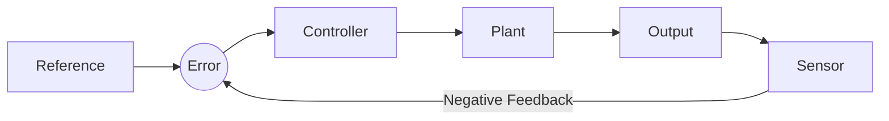

<div dir="rtl" align="right">

# Control Systems Fundamentals Using MATLAB
### أساسيات أنظمة السيطرة وتطبيقاتها في MATLAB — ARAN Flight Systems

<div align="center">


</div>

---

## نظرة عامة على الدليل (Project Overview)

هذا الدليل يجمع الأساسيات العملية لهندسة السيطرة (**Control Systems**) ويربط المعادلات النظرية مباشرة بالمحاكاة العددية داخل **MATLAB**، كجزء من مسار التأسيس الهندسي في مستودع **ARAN Flight Systems**. الفكرة هنا ليست كتابة موسوعة تغطي كل مواضيع السيطرة المتقدمة، بل بناء أرضية صلبة تخليك تقرأ معادلة أي نظام هندسي وتعرف سلوكه الزمني واستقراره قبل ما تبني متحكم طيران أو منظومة حقيقية، وتعرف بالضبط شنو الخطوات الجاية اللي تحتاج تتعمق بيها.

**بيئة التشغيل المطلوبة:**

* **MATLAB R2014a** (الأكواد كلها مجربة ومضبوطة للعمل عليه بسلاسة، وتشتغل أيضاً على الإصدارات الأحدث).
* حزمة **Control System Toolbox** (مطلوبة لدوال مثل `tf` و `step` و `stepinfo` و `pole`).

---

## 01 — مدخل إلى أنظمة السيطرة (Introduction to Control Systems)

ببساطة، نظام السيطرة هو مجموعة عناصر مترابطة تتعامل مع إشارة دخل حتى تجبر المنظومة على تنفيذ سلوك معين نريده منها. من ناحية البنية، نقسّم هذه الأنظمة إلى نوعين رئيسيين حسب وجود القياس الراجع من عدمه:

### نظام الحلقة المفتوحة (Open-Loop System)

هنا المتحكم يرسل أمره للنظام (**Plant**) ويمشي الأمر بدون ما يتأكد هل الخرج وصل للقيمة المطلوبة فعلاً أم لا؛ يعني ماكو أي تغذية راجعة (**Feedback**). إذا صار اضطراب خارجي—مثل هبة ريح مفاجئة على طائرة أو تغيّر حمل—النظام ما راح يحس بيه ولا يصححه.


### نظام الحلقة المغلقة (Closed-Loop System)

هنا تدخل التغذية الراجعة (**Feedback**) عن طريق حساس (**Sensor**) يقيس الخرج الفعلي ويرجّعه لنقطة المقارنة مع القيمة المرجعية (**Reference**). الفرق بين اللي نريده واللي صار فعلياً هو **إشارة الخطأ (Error Signal)**، وعليها يشتغل المتحكم ليعدّل الاستجابة لحظياً.



في حالة التغذية الراجعة السالبة وبافتراض حساس مثالي (كسبه يساوي واحد)، تكون معادلة الخطأ مباشرة:

$$
e(t) = r(t) - y(t)
$$

حيث يمثل $r(t)$ الإشارة المرجعية المطلوبة، و $y(t)$ الخرج الفعلي المقاس، أما $e(t)$ فهي إشارة الخطأ التي يحاول المتحكم تصغيرها قدر الإمكان.

---

## 02 — النمذجة الرياضية (Mathematical Modeling)

قبل ما تكتب سطر كود واحد أو تصمم متحكم، لازم تترجم النظام الفيزيائي إلى معادلات رياضية تصف تغيّره مع الزمن. المسار الكلاسيكي يبدأ بكتابة المعادلة التفاضلية للنظام باستخدام القوانين الفيزيائية (كيرشوف للكهرباء أو نيوتن للميكانيك)، وبعدها نطبق **تحويل لابلاس (Laplace Transform)** حتى نحول التفاضل المعقد إلى معادلات جبرية بسيطة تعطينا **دالة التحويل (Transfer Function)**.

للأنظمة الخطية ثابتة الزمن (**LTI Systems**) وبشرط أن تكون الشروط الابتدائية صفرية، تُعرّف دالة التحويل كنسبة الخرج إلى الدخل في مجال $s$:

$$
G(s) = \frac{Y(s)}{U(s)}
$$

### مثال تطبيقي: دائرة المقاومة والمكثف (RC Circuit)

لو أخذنا دائرة RC توالي بسيطة وطبقنا عليها قانون كيرشوف للجهد (**KVL**):

$$
V_{in} = V_R + V_C
$$

وبما أن تيار المكثف يساوي $i = C\frac{dv_c}{dt}$، نحصل على المعادلة التفاضلية:

$$
RC\frac{dv_c}{dt} + v_c = v_{in}
$$

الآن نحولها إلى مجال لابلاس (مع شروط ابتدائية صفرية):

$$
RCsV_C(s) + V_C(s) = V_{in}(s)
$$

نطلع $V_C(s)$ عامل مشترك ونقسم الخرج على الدخل لنصل إلى دالة التحويل:

$$
G(s) = \frac{1}{RCs + 1}
$$

أعلى أس لـ $s$ في المقام هو واحد، وهذا يعني مباشرة أننا أمام **نظام من المرتبة الأولى (First-Order System)**.

---

## 03 — أنظمة المرتبة الأولى (First-Order Systems)

كل نظام تصفه معادلة تفاضلية من الدرجة الأولى ينضبط تحت الصيغة القياسية التالية لدالة التحويل:

$$
G(s) = \frac{K}{\tau s + 1}
$$

في هذه الصيغة عندنا معاملان يتحكمان بكل شيء: $K$ وهو **كسب النظام (System Gain)** الذي يحدد وين راح يستقر الخرج بالنهاية، و $\tau$ وهو **الثابت الزمني (Time Constant)** الموجب الذي يحكم سرعة الاستجابة.

إذا سلطنا على هذا النظام دخل خطوة واحدة (**Unit Step Input**) وبشروط ابتدائية صفرية، تطلع الاستجابة الزمنية بالصيغة الأسية:

$$
y(t) = K(1 - e^{-t/\tau})
$$

الجميل في الثابت الزمني $\tau$ إنه يعطيك مقياساً سريعاً لسرعة النظام؛ فبعد مرور زمن يساوي $\tau$ بالضبط:

$$
y(\tau) = 0.632K
$$

بمعنى أن الخرج يقطع **$63.2\%$** من طريقه نحو القيمة النهائية. ومن نفس المعادلة نشتق معيارين مهمين لقياس الأداء، الأول هو **زمن الصعود (Rise Time)** من $10\%$ إلى $90\%$:

$$
T_r = \tau\ln(9) \approx 2.2\tau
$$

والثاني هو **زمن الاستقرار (Settling Time)** ضمن هامش خطأ $2\%$:

$$
T_s = -\tau\ln(0.02) \approx 3.912\tau
$$

### كود المحاكاة (MATLAB R2014a)

```matlab
clc;
clear;
close all;

K = 1;
tau = [0.25 0.5 1 2];
t = 0:0.01:10;

colors = lines(length(tau));

figure('Color','w');
hold on;

for n = 1:length(tau)

    T = tau(n);

    y = K*(1-exp(-t/T));

    plot(t,y,'Color',colors(n,:),...
        'LineWidth',2);

    Tr = log(9)*T;
    Ts = -log(0.02)*T;

    fprintf('Tau = %.2f s\n',T);
    fprintf('Rise Time = %.3f s\n',Tr);
    fprintf('Settling Time = %.3f s\n',Ts);

    plot(T,K*(1-exp(-1)),'o',...
        'Color',colors(n,:),...
        'MarkerFaceColor',colors(n,:),...
        'HandleVisibility','off');

end

plot(t,K*ones(size(t)),'k--',...
    'HandleVisibility','off');

xlabel('Time (s)');
ylabel('System Output');
title('First-Order Systems Comparison');

legend('Tau = 0.25 s',...
       'Tau = 0.5 s',...
       'Tau = 1 s',...
       'Tau = 2 s',...
       'Location','SouthEast');

axis([0 10 0 1.15]);

grid on;
box on;
hold off;

set(gcf,'PaperPositionMode','auto');

print(gcf,'01_First_Order.png',...
    '-dpng','-r300');

disp('Image saved successfully.');
```

### نتائج المحاكاة


| Time Constant (s) | Rise Time (s) | Settling Time (s) |
|---:|---:|---:|
| 0.25 | 0.549 | 0.978 |
| 0.50 | 1.099 | 1.956 |
| 1.00 | 2.197 | 3.912 |
| 2.00 | 4.394 | 7.824 |

### قراءة في المنحنيات

كل المنحنيات الأربعة بالرسم توصل بالنهاية لنفس القيمة ($y=1$) لأننا ثبتنا الكسب $K=1$، لكن الفرق الحقيقي هو بالزمن. كل ما تضاعف $\tau$، يتضاعف معه زمن الصعود والاستقرار بنفس النسبة الخطية تقريباً (لاحظ الجدول: عند `0.50` ثانية زمن الاستقرار `1.956`، وعند `1.00` ثانية صار `3.912`). النقاط الملونة المثبتة على المنحنيات توضح لحظة وصول كل نظام إلى $63.2\%$ من قيمته النهائية، وما نلاحظ أي تجاوز (**Overshoot**) لأن أنظمة المرتبة الأولى بطبيعتها ما تتذبذب مع دخل الخطوة.

---

## 04 — أنظمة المرتبة الثانية (Second-Order Systems)

هنا يبدأ الشغل الحقيقي في هندسة السيطرة، لأن أغلب الأنظمة الميكانيكية وأنظمة توجيه الطائرات المسيرة (مثل استجابة زاوية الميلان *Pitch* والدوران *Roll*) تُنمذج كأنظمة من المرتبة الثانية. صيغتها القياسية في مجال لابلاس هي:

$$
G(s) = \frac{K\omega_n^2}{s^2 + 2\zeta\omega_n s + \omega_n^2}
$$

سلوك المنحنى كله محكوم بقيمتين: **التردد الطبيعي ($\omega_n$)** الذي يعكس سرعة النظام الكامنة، و **نسبة التخميد ($\zeta$)** التي تحدد هل النظام راح يتذبذب أم يستقر بهدوء. اعتماداً على قيمة $\zeta$، نصادف أربع حالات معروفة:

| Damping Ratio | System Type | سلوك الاستجابة باختصار |
|---|---|---|
| $\zeta = 0$ | Undamped | تذبذب مستمر للأبد بنفس السعة بدون استقرار |
| $0 < \zeta < 1$ | Underdamped | استجابة سريعة لكن مع تجاوز (Overshoot) وتذبذبات تخمد تدريجياً |
| $\zeta = 1$ | Critically Damped | أسرع وصول ممكن للقيمة النهائية بدون أي تجاوز (في النموذج القياسي) |
| $\zeta > 1$ | Overdamped | استجابة بطيئة وثقيلة بدون تجاوز أو تذبذب |

في حالة التخميد الناقص ($0 < \zeta < 1$)، يظهر تردد فعلي أقل قليلاً من التردد الطبيعي يُسمى **التردد الطبيعي المخمد (Damped Natural Frequency)**:

$$
\omega_d = \omega_n\sqrt{1 - \zeta^2}
$$

### كود المحاكاة (MATLAB R2014a)

```matlab
clc;
clear;
close all;

wn = 10;
K = 1;

zeta = [0 0.3 1 2];

t = 0:0.001:3;

colors = lines(length(zeta));

names = {'Undamped',...
         'Underdamped',...
         'Critically Damped',...
         'Overdamped'};

figure('Color','w');
hold on;

for n = 1:length(zeta)

    z = zeta(n);

    num = K*wn^2;
    den = [1 2*z*wn wn^2];

    G = tf(num,den);

    [y,T] = step(G,t);

    plot(T,y,'Color',colors(n,:),...
        'LineWidth',2);

    fprintf('\n%s\n',names{n});
    fprintf('Damping Ratio = %.2f\n',z);

    disp(pole(G));

    if z > 0

        info = stepinfo(G);
        disp(info);

    else

        disp('No finite settling time.');

    end

end

plot(t,K*ones(size(t)),'k--',...
    'HandleVisibility','off');

xlabel('Time (s)');
ylabel('System Output');

title('Effect of Damping Ratio');

legend(names,'Location','Best');

grid on;
box on;
hold off;

set(gcf,'PaperPositionMode','auto');

print(gcf,'02_Second_Order.png',...
    '-dpng','-r300');

disp('Image saved successfully.');
```


### ملاحظة عملية من المحاكاة

رغم إننا ثبتنا $\omega_n = 10\text{ rad/s}$ في الحالات الأربعة، تغيير $\zeta$ قلب شكل الاستجابة تماماً. المنحنى الأزرق ($\zeta=0$) بقى يهتز بين $0$ و $2$ وما استقر أبداً، بينما الأخضر ($\zeta=0.3$) وصل للهدف بسرعة لكنه تجاوزه بقوة وتذبذب قبل ما يهدأ—في عالم الدرونات هذا التجاوز يعني اهتزاز واضح بجسم الطائرة وصعوبة بتثبيت الكاميرا. أما الأحمر ($\zeta=1$) والسماوي ($\zeta=2$) فحافظوا على استجابة ناعمة بلا تجاوز، مع تفوق واضح للحالة الحرجة بالسرعة مقارنة بالـ Overdamped البطيء.

---

## 05 — تحليل الاستجابة الزمنية (Time Response Analysis)

لما نفحص استجابة أي نظام مستقر لدخل معين، نقدر نفصلها رياضياً إلى جزأين:

$$
y(t) = y_{tr}(t) + y_{ss}(t)
$$

الجزء الأول $y_{tr}(t)$ هو **الاستجابة العابرة (Transient Response)** اللي تمثل فترة الانتقال والتذبذب المؤقت قبل ما تتلاشى، والجزء الثاني $y_{ss}(t)$ هو **استجابة الحالة المستقرة (Steady-State Response)** اللي يبقى عليها النظام بعد مرور زمن كافٍ.

### معاملات قياس الأداء (Performance Parameters)

حتى نقارن بين نظامين أو نضبط متحكم بشكل هندسي دقيق، نعتمد على خمس مؤشرات رئيسية (في النموذج القياسي ناقص التخميد):

* **زمن الصعود ($T_r$):** الزمن اللي تحتاجه الإشارة لتصعد من $10\%$ إلى $90\%$ من القيمة النهائية.
* **زمن الذروة ($T_p$):** لحظة وصول المنحنى لأول وأعلى قمة:

$$
T_p = \frac{\pi}{\omega_n\sqrt{1 - \zeta^2}}
$$

* **نسبة التجاوز ($OS\%$):** النسبة المئوية لارتفاع القمة الأولى فوق القيمة المستقرة، وتعتمد فقط على $\zeta$:

$$
OS\% = 100e^{\frac{-\pi\zeta}{\sqrt{1 - \zeta^2}}}
$$

* **زمن الاستقرار ($T_s$):** الزمن اللازم لدخول المنحنى وبقائه داخل نطاق $\pm 2\%$ حول القيمة النهائية، ويُحسب بالتقريب الشائع:

$$
T_s \approx \frac{4}{\zeta\omega_n}
$$

* **خطأ الحالة المستقرة ($e_{ss}$):** الفرق الدائم المتبقي بين القيمة المرجعية والخرج النهائي:

$$
e_{ss} = \lim_{t\to\infty}[r(t) - y(t)]
$$

### مثال عددي وتحقق عبر MATLAB

لنأخذ دالة التحويل التالية:

$$
G(s) = \frac{100}{s^2 + 15s + 100}
$$

بالمطابقة المباشرة مع المقام القياسي $s^2 + 2\zeta\omega_n s + \omega_n^2$ نجد:

$$
\omega_n = \sqrt{100} = 10\text{ rad/s}
$$

$$
\zeta = \frac{15}{2(10)} = 0.75
$$

### كود المحاكاة (MATLAB R2014a)

```matlab
clc;
clear;
close all;

G = tf(100,[1 15 100]);

wn = 10;
zeta = 0.75;

wd = wn*sqrt(1-zeta^2);

Tp = pi/wd;

OS = 100*exp(-pi*zeta/sqrt(1-zeta^2));

Ts = 4/(zeta*wn);

info = stepinfo(G);

K = dcgain(G);

fprintf('Natural Frequency = %.2f rad/s\n',wn);
fprintf('Damping Ratio = %.2f\n',zeta);
fprintf('Peak Time = %.4f s\n',Tp);
fprintf('Overshoot = %.4f %%\n',OS);
fprintf('Approximate Settling Time = %.4f s\n',Ts);

disp(info);

t = 0:0.001:2;

[y,T] = step(G,t);

figure('Color','w');
hold on;

plot(T,y,'b','LineWidth',2);

plot(t,K*ones(size(t)),'k--');

plot(t,1.02*K*ones(size(t)),'g--');

plot(t,0.98*K*ones(size(t)),'g--');

plot(info.PeakTime,info.Peak,'ro',...
    'MarkerFaceColor','r');

xlabel('Time (s)');
ylabel('System Output');

title('Time Response Characteristics');

legend('Step Response',...
       'Steady-State Value',...
       'Upper 2% Limit',...
       'Lower 2% Limit',...
       'Peak Value',...
       'Location','Best');

grid on;
box on;
hold off;

set(gcf,'PaperPositionMode','auto');

print(gcf,'03_Time_Response.png',...
    '-dpng','-r300');

disp('Image saved successfully.');
```

### نتائج المحاكاة

| Parameter | Theoretical Value |
|---|---:|
| Natural Frequency | $10\text{ rad/s}$ |
| Damping Ratio | $0.75$ |
| Peak Time | $0.475\text{ s}$ |
| Overshoot | $2.84\%$ |
| Approximate Settling Time | $0.533\text{ s}$ |
| Steady-State Value | $1$ |

### ماذا تخبرنا هذه الأرقام؟

النقطة الحمراء على المنحنى تحدد لحظة الذروة بدقة، والخطان الأخضران المتقطعان يرسمان حدود الـ $\pm 2\%$ (**Settling Band**). اختيار نسبة تخميد قريبة من `0.7` إلى `0.75` مثل هذا المثال يُعد خياراً عملياً جداً في تطبيقات الطيران (مثل ضبط زاوية الميلان *Pitch* في الطائرات المسيرة)، لأنك تحصل على استجابة سريعة جداً مع تجاوز خفيف لا يتعدى $2.84\%$، وهو عملياً غير مؤثر. انتبه أيضاً لنقطة مهمة عند مقارنة ناتج `stepinfo` بالمعادلة اليدوية: قيمة زمن الاستقرار اللي يعطيها ماتلاب راح تختلف قليلاً عن `0.533 s`، والسبب إن الدالة تحسب لحظة الدخول الفعلية داخل النطاق عددياً، بينما قانون $\frac{4}{\zeta\omega_n}$ يعتمد على الغلاف الأسي التقريبي فقط.

---

## 06 — الأقطاب والأصفار والاستقرار (Poles, Zeros and Stability)

إذا كانت دالة التحويل مكتوبة بصيغتها المختزلة (بعد اختصار أي جذور مشتركة):

$$
G(s) = \frac{N(s)}{D(s)}
$$

فإن جذور البسط ($N(s)=0$) تُعرف بـ **الأصفار (Zeros)**، وجذور المقام ($D(s)=0$) تُعرف بـ **الأقطاب (Poles)**. توزيع هذه الأقطاب على المستوى المركب (**s-plane**) يختصر عليك الكثير من الحسابات؛ لأن موقع القطب يحدد مصير النظام من ناحية الاستقرار مباشرة:

* **النصف الأيسر (Left Half Plane):** للأنظمة المستمرة الكسرية المناسبة، إذا وقعت جميع الأقطاب بجزء حقيقي سالب فهذا يضمن استقرار **BIBO** (أي دخل محدود يعطي خرجاً محدوداً).
* **النصف الأيمن (Right Half Plane):** وجود قطب واحد فقط بجزء حقيقي موجب كافٍ لجعل النظام غير مستقر (**Unstable**) وتنمو استجابته بشكل أسي نحو ما لا نهاية.
* **المحور التخيلي (Imaginary Axis):** إذا وُجدت أقطاب بسيطة غير مكررة على المحور التخيلي (وبقية الأقطاب في النصف الأيسر)، يدخل النظام في حالة **استقرار حدي (Marginal Stability)** بالنسبة لاستجابته الطبيعية، لكنه لا يُعتبر مستقراً بمعيار BIBO (لأن إدخال إشارة جيبية بنفس تردده يسبب رنيناً غير محدود).

### كود المحاكاة (MATLAB R2014a)

```matlab
clc;
clear;
close all;

G1 = tf(1,[1 2 2]);
G2 = tf(1,[1 0 4]);
G3 = tf(1,[1 -2 2]);

P1 = pole(G1);
P2 = pole(G2);
P3 = pole(G3);

disp('Stable System Poles:');
disp(P1);

disp('Imaginary Axis Poles:');
disp(P2);

disp('Unstable System Poles:');
disp(P3);

figure('Color','w');
hold on;

plot(real(P1),imag(P1),'gx',...
    'MarkerSize',12,'LineWidth',2);

plot(real(P2),imag(P2),'bx',...
    'MarkerSize',12,'LineWidth',2);

plot(real(P3),imag(P3),'rx',...
    'MarkerSize',12,'LineWidth',2);

plot([-3 3],[0 0],'k--',...
    'HandleVisibility','off');

plot([0 0],[-3 3],'k--',...
    'HandleVisibility','off');

xlabel('Real Axis');
ylabel('Imaginary Axis');

title('Pole Location and Stability');

legend('Stable',...
       'Imaginary Axis Poles',...
       'Unstable',...
       'Location','Best');

axis([-3 3 -3 3]);
axis square;

grid on;
box on;
hold off;

set(gcf,'PaperPositionMode','auto');

print(gcf,'04_Poles_Stability.png',...
    '-dpng','-r300');

disp('Image saved successfully.');
```

### نتائج المحاكاة

| System | Poles | Stability |
|---|---|---|
| $G_1$ | $-1 \pm j$ | Stable |
| $G_2$ | $\pm 2j$ | Marginal |
| $G_3$ | $1 \pm j$ | Unstable |

### خلاصة الفحص الرياضي

بنظرة واحدة على مخطط الـ `s-plane` قدرنا نحكم على استقرار الأنظمة الثلاثة بدون ما نضطر نرسم استجابتها الزمنية أصلاً. طبعاً في النماذج الثلاثة هنا البسط ثابت (`1`) فما عندنا أصفار محدودة، لكن في الأنظمة الأعلى تعقيداً لازم ننتبه للأصفار أيضاً لأنها رغم عدم تأثيرها على شرط الاستقرار نفسه، إلا أنها تغيّر بشكل واضح من مقدار التجاوز وشكل الاستجابة العابرة.

---

## 07 — مدخل إلى المتحكمات (Introduction to Controllers)

دور المتحكم (**Controller**) في الحلقة المغلقة هو أخذ إشارة الخطأ وتحويلها إلى أمر تحكم مناسب يوجّه النظام نحو الهدف. أشهر ثلاث آليات كلاسيكية لبناء إشارة التحكم هي:

* **المتحكم التناسبي (Proportional — P):** يتفاعل مع الخطأ الحالي لحظة بلحظة (**Present Error**)؛ كل ما كبر الخطأ زادت قوة التصحيح.
* **المتحكم التكاملي (Integral — I):** يراقب تراكم الخطأ مع مرور الزمن (**Accumulated Error**)، وهو المسؤول الأساسي عن تصفير خطأ الحالة المستقرة (مثل تثبيت ارتفاع الدرون بالضبط رغم تغير وزن البطارية أو وجود رياح).
* **المتحكم التفاضلي (Derivative — D):** يقرأ سرعة ومعدل تغيّر الخطأ (**Rate of Change**)، فيشتغل كمخمّد يتوقع الحركة القادمة ويقلل التجاوز والاهتزاز.

عملياً، ندمج هذه الآليات معاً لنحصل على متحكمات **PI** و **PD** و **PID** (وهو العمود الفقري لمعظم متحكمات الطيران مثل *ArduPilot*). لكن خطأ شائع يقع فيه المبتدئون هو الاعتقاد بأن مجرد إضافة PID يضمن استقرار النظام تلقائياً؛ الحقيقة إن اختيار معاملات خاطئة (مثل رفع الكسب التناسبي أو التكاملي زيادة عن اللزوم) ممكن يدفع أقطاب الحلقة المغلقة نحو النصف الأيمن ويخلي النظام ينهار. هنا نكتفي بالمفهوم التأسيسي، على أن تكون طرق التصميم والضبط التفصيلية في أقسام مخصصة لاحقاً.

---

## 08 — إشارات الدخل القياسية (Standard Input Signals)

لأن إشارات التشغيل الحقيقية تكون عشوائية وصعبة المقارنة، نتفق في هندسة السيطرة على اختبار الأنظمة بأربع إشارات قياسية معروفة حتى نكشف خصائصها الديناميكية بدقة: **النبضة الواحدة (Unit Impulse)** كنبضة مثالية مساحتها تساوي $1$، و **الخطوة الواحدة (Unit Step)** التي تحاكي تغيراً مفاجئاً وثابتاً في الأمر، و **المنحدرة (Unit Ramp)** لاختبار قدرة النظام على تتبع هدف يتحرك بسرعة ثابتة، وأخيراً **الإشارة الجيبية (Sinusoidal Input)** التي تُستخدم بكثرة في التحليل الترددي.

### تحويل لابلاس للإشارات القياسية

| Input Signal | Laplace Transform |
|---|---|
| Unit Impulse | $1$ |
| Unit Step | $\frac{1}{s}$ |
| Unit Ramp | $\frac{1}{s^2}$ |
| Sinusoidal Input | $\frac{\omega}{s^2 + \omega^2}$ |

### كود المحاكاة (MATLAB R2014a)

```matlab
clc;
clear;
close all;

dt = 0.01;

t = -2:dt:5;

% Impulse Approximation

impulse = zeros(size(t));

[~,idx] = min(abs(t));

impulse(idx) = 1/dt;

% Unit Step

step_signal = double(t>=0);

% Unit Ramp

ramp = t.*step_signal;

% Sinusoidal Input

sine_signal = sin(2*pi*t);

figure('Color','w');

subplot(2,2,1);

stem(t,impulse,'b');

title('Impulse Approximation');
xlabel('Time (s)');
grid on;

subplot(2,2,2);

plot(t,step_signal,'b','LineWidth',2);

title('Unit Step');
xlabel('Time (s)');

axis([-2 5 -0.2 1.2]);

grid on;

subplot(2,2,3);

plot(t,ramp,'b','LineWidth',2);

title('Unit Ramp');
xlabel('Time (s)');
grid on;

subplot(2,2,4);

plot(t,sine_signal,'b','LineWidth',2);

title('Sinusoidal Input');
xlabel('Time (s)');
grid on;

set(gcf,'PaperPositionMode','auto');

print(gcf,'05_Input_Signals.png',...
    '-dpng','-r300');

disp('Image saved successfully.');
```


### تنبيه برمجي مهم

دالة النبضة المثالية (**Dirac Delta**) ارتفاعها ما لا نهاية وعرضها صفر، وهذا مستحيل تمثيله حرفياً داخل مصفوفة عددية في ماتلاب. لذلك بالكود استعضنا عنها بتقريب عددي ذكي يحافظ على شرط المساحة الواحدة عند $t=0$ بجعل ارتفاع النبضة يساوي `1/dt`:

$$
100 \times 0.01 = 1
$$

ونقطة ثانية تستاهل الانتباه: بالكود رسمنا الإشارة الجيبية على كامل المحور الزمني من `-2` إلى `5` للتوضيح البصري، بينما تحويل لابلاس الأحادي الموجود بالجدول ($\frac{\omega}{s^2+\omega^2}$) يفترض رياضياً أن الإشارة تبدأ من $t \ge 0$ فقط.

---

## 09 — تطبيقات هندسية متماثلة رياضياً (Engineering Applications)

أقوى ميزة في هندسة السيطرة إنك لما تفهم معادلات المرتبة الأولى والثانية، تقدر تحلل دوائر كهربائية ومنظومات ميكانيكية وحرارية بنفس الأدوات تماماً، لأنها تخضع لنفس الهيكل التفاضلي:

* **دائرة المقاومة والمكثف (RC Circuit — مرتبة أولى):**

$$
RC\frac{dv_c}{dt} + v_c = v_{in}, \quad \tau = RC
$$

* **دائرة المقاومة والمحاثة (RL Circuit — مرتبة أولى):**

$$
L\frac{di}{dt} + Ri = v_{in}, \quad \tau = \frac{L}{R}
$$

* **دائرة التوالي RLC (مرتبة ثانية عند قياس جهد المكثف):**

$$
LC\frac{d^2v_c}{dt^2} + RC\frac{dv_c}{dt} + v_c = v_{in}
$$

* **نظام الكتلة والنابض والمخمد (Mass-Spring-Damper — مرتبة ثانية):**

$$
m\frac{d^2x}{dt^2} + b\frac{dx}{dt} + kx = F
$$

* **النموذج الحراري المبسط (Thermal System — مرتبة أولى):** يعتمد على المقاومة الحرارية ($R_{th}$) والسعة الحرارية ($C_{th}$):

$$
C_{th}\frac{dT}{dt} + \frac{T - T_a}{R_{th}} = Q
$$

### التشابه الرياضي بين الأنظمة

رغم إن التيار الكهربائي يختلف فيزيائياً عن حركة النابض أو انتقال الحرارة، إلا أن سلوكهم الرياضي متطابق تقريباً؛ المحاثة $L$ تلعب نفس دور الكتلة $m$ (القصور الذاتي)، والمقاومة $R$ تشبه المخمّد $b$ (تبديد الطاقة). ونفس المنطق ينطبق تماماً لما ننتقل لنمذجة ديناميكية زاوية الميلان أو الارتفاع في الطائرات المسيرة؛ بمجرد ما تستخرج المعادلة التفاضلية تصبح كل أدوات هذا الدليل جاهزة للتطبيق المباشر عليها.

---

## 10 — خارطة طريق للتعمق لاحقاً (Learning Roadmap)

إذا هضمت الأقسام السابقة وجربت تعدل قيم المعاملات بالأكواد وشفت تأثيرها بعينك، فالمسار الطبيعي للانتقال لمستوى متقدم يمشي بهذا الترتيب:
تبدأ بتقوية الأسس الرياضية (المعادلات التفاضلية، الأعداد المركبة، وتحويل لابلاس)، ثم تتوسع في نمذجة الأنظمة المعقدة واختصار المخططات الكتلية (**Block Diagrams**) والانتقال من دوال التحويل إلى تمثيل **فضاء الحالة (State-Space Representation)** الذي تحتاجه بشدة في أنظمة الطيران متعددة المداخل والمخارج. بعدها تتعمق أكثر في فحص الاستقرار بأدوات مثل معيار **روث-هورويتز (Routh-Hurwitz)** ومسار الجذور (**Root Locus**)، وصولاً إلى التحليل الترددي عبر مخططات **بودي (Bode)** و **نايكويست (Nyquist)**، ومن هناك تفتح لك أبواب نظرية السيطرة الحديثة وتصميم المتحكمات المتقدمة.

---

## الخلاصة

حاولنا في هذا التوثيق نكسر الجمود النظري لمادة السيطرة ونربط كل قانون بسطر كود ورسم بياني فعلي داخل MATLAB. غطينا أنظمة المرتبة الأولى والثانية، وشفنا عملياً شلون يتحكم الثابت الزمني $\tau$ ونسبة التخميد $\zeta$ وموقع الأقطاب بمصير الاستجابة، مروراً بإشارات الاختبار القياسية والتشابه بين الأنظمة الفيزيائية. الفهم الحقيقي يبدأ لما تبطّل تحفظ القوانين وتصير تتخيل شكل المنحنى بمجرد ما تشوف دالة التحويل.

---

## المراجع (References)

1. Katsuhiko Ogata — *Modern Control Engineering*.
2. Norman S. Nise — *Control Systems Engineering*.
3. [MathWorks — Control System Toolbox Documentation](https://www.mathworks.com/help/control/)
4. [University of Michigan — Control Tutorials for MATLAB and Simulink](https://ctms.engin.umich.edu/)

---

## Simulation Notes

* **MATLAB Version:** R2014a (Tested & Verified).
* **Toolbox:** Control System Toolbox.
* **Image Resolution:** 300 DPI (`PNG` format).
* **Directory Note:** السكربتات تحفظ الصور في مجلد العمل الحالي مباشرة، وتُعرض داخل هذا التوثيق من مجلد `images/` الموجود بجانب ملف `README.md`.
* **Repository:** ARAN Flight Systems — Control & Modeling Division.

</div>
