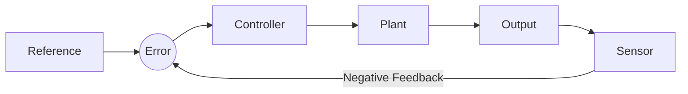

# Control Systems Fundamentals Using MATLAB

## أساسيات أنظمة السيطرة باستخدام MATLAB

## Project Overview

يهدف هذا المشروع إلى تقديم أساسيات أنظمة السيطرة (Control Systems)، وربط المفاهيم النظرية بالنمذجة الرياضية (Mathematical Modeling) والمحاكاة (Simulation) باستخدام MATLAB.

لا يهدف المشروع إلى تغطية جميع جوانب هندسة السيطرة، وإنما بناء أساس علمي يمكّن القارئ من فهم سلوك الأنظمة الهندسية وتحليلها ومعرفة المواضيع التي يحتاج إلى دراستها مستقبلاً.

### Software Requirements

- MATLAB 2014
- Control System Toolbox

---

## 01 — Introduction to Control Systems

نظام السيطرة (Control System) هو مجموعة من المكونات التي تعمل معاً لتحقيق سلوك مطلوب لنظام معين.

### Open-Loop System

نظام الحلقة المفتوحة هو نظام لا يستخدم المخرجات لتصحيح إشارة التحكم، أي إنه لا يعتمد على التغذية الراجعة (Feedback).


### Closed-Loop System

نظام الحلقة المغلقة يعتمد على التغذية الراجعة (Feedback) لمقارنة القيمة المرجعية (Reference) بالقيمة الفعلية للمخرجات (Output)، وتحديد إشارة الخطأ (Error Signal).



في حالة التغذية الراجعة السالبة والقياس المثالي:

$$
e(t)=r(t)-y(t)
$$

حيث تمثل $r(t)$ القيمة المرجعية، وتمثل $y(t)$ المخرجات الفعلية، بينما تمثل $e(t)$ إشارة الخطأ.

---

## 02 — Mathematical Modeling

النمذجة الرياضية (Mathematical Modeling) هي عملية تمثيل النظام الفيزيائي (Physical System) باستخدام المعادلات الرياضية التي تصف سلوكه مع الزمن.

تبدأ العملية بكتابة المعادلات التفاضلية (Differential Equations)، ثم استخدام تحويل لابلاس (Laplace Transform) للحصول على دالة التحويل (Transfer Function).

بالنسبة للأنظمة الخطية ثابتة الزمن (Linear Time-Invariant Systems) وبشروط ابتدائية صفرية:

$$
G(s)=\frac{Y(s)}{U(s)}
$$

### Example: RC Circuit

باستخدام قانون كيرشوف للجهد (Kirchhoff's Voltage Law):

$$
V_{in}=V_R+V_C
$$

$$
RC\frac{dv_c}{dt}+v_c=v_{in}
$$

بتطبيق تحويل لابلاس:

$$
RCsV_C(s)+V_C(s)=V_{in}(s)
$$

نحصل على دالة التحويل:

$$
G(s)=\frac{1}{RCs+1}
$$

يمثل هذا النموذج نظاماً من المرتبة الأولى (First-Order System).

---

## 03 — First-Order Systems

نظام المرتبة الأولى (First-Order System) هو نظام تكون أعلى رتبة للمعادلة التفاضلية التي تصفه هي المرتبة الأولى.

الصيغة القياسية لدالة التحويل:

$$
G(s)=\frac{K}{\tau s+1}
$$

يمثل $K$ كسب النظام (System Gain)، بينما يمثل $\tau$ الثابت الزمني (Time Constant) الموجب الذي يحدد سرعة الاستجابة.

عند تطبيق إشارة الخطوة الواحدة (Unit Step Input) وبشروط ابتدائية صفرية:

$$
y(t)=K(1-e^{-t/\tau})
$$

عند مرور زمن يساوي الثابت الزمني:

$$
y(\tau)=0.632K
$$

أي إن النظام يصل إلى 63.2% من التغير النهائي.

زمن الصعود (Rise Time) من 10% إلى 90%:

$$
T_r=\tau\ln(9)\approx2.2\tau
$$

زمن الاستقرار (Settling Time) وفق معيار 2%:

$$
T_s=-\tau\ln(0.02)\approx3.912\tau
$$

### MATLAB Code

```matlab
clc;
clear;
close all;

K = 1;
tau = [0.25 0.5 1 2];
t = 0:0.01:10;

colors = lines(length(tau));

figure('Color','w');
hold on;

for n = 1:length(tau)

    T = tau(n);

    y = K*(1-exp(-t/T));

    plot(t,y,'Color',colors(n,:),...
        'LineWidth',2);

    Tr = log(9)*T;
    Ts = -log(0.02)*T;

    fprintf('Tau = %.2f s\n',T);
    fprintf('Rise Time = %.3f s\n',Tr);
    fprintf('Settling Time = %.3f s\n',Ts);

    plot(T,K*(1-exp(-1)),'o',...
        'Color',colors(n,:),...
        'MarkerFaceColor',colors(n,:),...
        'HandleVisibility','off');

end

plot(t,K*ones(size(t)),'k--',...
    'HandleVisibility','off');

xlabel('Time (s)');
ylabel('System Output');
title('First-Order Systems Comparison');

legend('Tau = 0.25 s',...
       'Tau = 0.5 s',...
       'Tau = 1 s',...
       'Tau = 2 s',...
       'Location','SouthEast');

axis([0 10 0 1.15]);

grid on;
box on;
hold off;

set(gcf,'PaperPositionMode','auto');

print(gcf,'01_First_Order.png',...
    '-dpng','-r300');

disp('Image saved successfully.');
```

### Simulation Results


| Time Constant (s) | Rise Time (s) | Settling Time (s) |
|---:|---:|---:|
| 0.25 | 0.549 | 0.978 |
| 0.50 | 1.099 | 1.956 |
| 1.00 | 2.197 | 3.912 |
| 2.00 | 4.394 | 7.824 |

### Engineering Insight

نلاحظ أن جميع الأنظمة تصل إلى القيمة النهائية نفسها، ولكن بسرعات مختلفة.

كلما زاد الثابت الزمني (Time Constant)، أصبحت الاستجابة أبطأ وزاد زمن الصعود (Rise Time) وزمن الاستقرار (Settling Time)، دون تغيير القيمة النهائية (Final Value).

تمثل النقاط الموجودة على المنحنيات اللحظة التي تصل فيها الاستجابة إلى 63.2% من قيمتها النهائية.

---

## 04 — Second-Order Systems

نظام المرتبة الثانية (Second-Order System) هو نظام تكون أعلى رتبة للمعادلة التفاضلية التي تصفه هي المرتبة الثانية.

الصيغة القياسية لدالة التحويل:

$$
G(s)=\frac{K\omega_n^2}{s^2+2\zeta\omega_ns+\omega_n^2}
$$

يعتمد سلوك النظام بصورة أساسية على التردد الطبيعي (Natural Frequency) الذي يرمز له بـ $\omega_n$، ونسبة التخميد (Damping Ratio) التي يرمز لها بـ $\zeta$.

عندما تكون نسبة التخميد صفراً، يكون النظام غير مخمد (Undamped System)، ويستمر بالتذبذب دون استقرار.

عندما تقع نسبة التخميد بين الصفر والواحد، يكون النظام ناقص التخميد (Underdamped System)، وتتناقص تذبذباته تدريجياً مع الزمن.

عندما تساوي نسبة التخميد الواحد، يكون النظام ذا تخميد حرج (Critically Damped System)، ويصل إلى القيمة النهائية دون تجاوز في النموذج القياسي.

أما عندما تكون نسبة التخميد أكبر من الواحد، فيكون النظام زائد التخميد (Overdamped System)، وتصبح استجابته أبطأ دون تجاوز.

| Damping Ratio | System Type |
|---|---|
| ζ = 0 | Undamped |
| 0 < ζ < 1 | Underdamped |
| ζ = 1 | Critically Damped |
| ζ > 1 | Overdamped |

في حالة التخميد الناقص يكون التردد الطبيعي المخمد (Damped Natural Frequency):

$$
\omega_d=\omega_n\sqrt{1-\zeta^2}
$$

### MATLAB Code

```matlab
clc;
clear;
close all;

wn = 10;
K = 1;

zeta = [0 0.3 1 2];

t = 0:0.001:3;

colors = lines(length(zeta));

names = {'Undamped',...
         'Underdamped',...
         'Critically Damped',...
         'Overdamped'};

figure('Color','w');
hold on;

for n = 1:length(zeta)

    z = zeta(n);

    num = K*wn^2;
    den = [1 2*z*wn wn^2];

    G = tf(num,den);

    [y,T] = step(G,t);

    plot(T,y,'Color',colors(n,:),...
        'LineWidth',2);

    fprintf('\n%s\n',names{n});
    fprintf('Damping Ratio = %.2f\n',z);

    disp(pole(G));

    if z > 0

        info = stepinfo(G);
        disp(info);

    else

        disp('No finite settling time.');

    end

end

plot(t,K*ones(size(t)),'k--',...
    'HandleVisibility','off');

xlabel('Time (s)');
ylabel('System Output');

title('Effect of Damping Ratio');

legend(names,'Location','Best');

grid on;
box on;
hold off;

set(gcf,'PaperPositionMode','auto');

print(gcf,'02_Second_Order.png',...
    '-dpng','-r300');

disp('Image saved successfully.');
```

### Simulation Results


### Engineering Insight

عند تثبيت التردد الطبيعي (Natural Frequency)، نلاحظ أن تغيير نسبة التخميد يؤدي إلى تغير واضح في طبيعة الاستجابة.

يستمر المنحنى الأزرق بالتذبذب، بينما يظهر المنحنى الأخضر تجاوزاً (Overshoot) وتذبذبات تتناقص مع الزمن.

أما المنحنيان الأحمر والسماوي فيمثلان استجابتين غير متذبذبتين في النموذج المدروس.

---

## 05 — Time Response Analysis

تحليل الاستجابة الزمنية (Time Response Analysis) هو دراسة كيفية تغير مخرجات النظام مع الزمن عند تطبيق إشارة دخل معينة.

تتكون الاستجابة من جزأين أساسيين:

$$
y(t)=y_{tr}(t)+y_{ss}(t)
$$

تمثل الاستجابة العابرة (Transient Response) السلوك المؤقت للنظام، بينما تمثل استجابة الحالة المستقرة (Steady-State Response) الجزء المتبقي بعد زوال الاستجابة العابرة في النظام المستقر.

### Performance Parameters

زمن الصعود (Rise Time) هو الزمن اللازم لانتقال الاستجابة من 10% إلى 90% من القيمة النهائية وفق التعريف المستخدم هنا.

زمن الذروة (Peak Time) هو الزمن اللازم للوصول إلى الذروة الأولى في النموذج القياسي ناقص التخميد:

$$
T_p=\frac{\pi}{\omega_n\sqrt{1-\zeta^2}}
$$

نسبة التجاوز (Percentage Overshoot) تمثل مقدار تجاوز الاستجابة للقيمة النهائية:

$$
OS\%=100e^{\frac{-\pi\zeta}{\sqrt{1-\zeta^2}}}
$$

زمن الاستقرار (Settling Time) وفق التقريب الشائع لمعيار 2%:

$$
T_s\approx\frac{4}{\zeta\omega_n}
$$

خطأ الحالة المستقرة (Steady-State Error) يمثل الفرق النهائي بين القيمة المرجعية والمخرجات:

$$
e_{ss}=\lim_{t\to\infty}[r(t)-y(t)]
$$

### Mathematical Example

لدينا دالة التحويل:

$$
G(s)=\frac{100}{s^2+15s+100}
$$

بمقارنتها مع الصيغة القياسية:

$$
\omega_n=\sqrt{100}=10\ rad/s
$$

$$
\zeta=\frac{15}{2(10)}=0.75
$$

### MATLAB Code

```matlab
clc;
clear;
close all;

G = tf(100,[1 15 100]);

wn = 10;
zeta = 0.75;

wd = wn*sqrt(1-zeta^2);

Tp = pi/wd;

OS = 100*exp(-pi*zeta/sqrt(1-zeta^2));

Ts = 4/(zeta*wn);

info = stepinfo(G);

K = dcgain(G);

fprintf('Natural Frequency = %.2f rad/s\n',wn);
fprintf('Damping Ratio = %.2f\n',zeta);
fprintf('Peak Time = %.4f s\n',Tp);
fprintf('Overshoot = %.4f %%\n',OS);
fprintf('Approximate Settling Time = %.4f s\n',Ts);

disp(info);

t = 0:0.001:2;

[y,T] = step(G,t);

figure('Color','w');
hold on;

plot(T,y,'b','LineWidth',2);

plot(t,K*ones(size(t)),'k--');

plot(t,1.02*K*ones(size(t)),'g--');

plot(t,0.98*K*ones(size(t)),'g--');

plot(info.PeakTime,info.Peak,'ro',...
    'MarkerFaceColor','r');

xlabel('Time (s)');
ylabel('System Output');

title('Time Response Characteristics');

legend('Step Response',...
       'Steady-State Value',...
       'Upper 2% Limit',...
       'Lower 2% Limit',...
       'Peak Value',...
       'Location','Best');

grid on;
box on;
hold off;

set(gcf,'PaperPositionMode','auto');

print(gcf,'03_Time_Response.png',...
    '-dpng','-r300');

disp('Image saved successfully.');
```

### Simulation Results


| Parameter | Theoretical Value |
|---|---:|
| Natural Frequency | 10 rad/s |
| Damping Ratio | 0.75 |
| Peak Time | 0.475 s |
| Overshoot | 2.84% |
| Approximate Settling Time | 0.533 s |
| Steady-State Value | 1 |

### Engineering Insight

تمثل النقطة الحمراء قيمة الذروة (Peak Value)، بينما يمثل الخطان الأخضران حدود نطاق الاستقرار (Settling Band) البالغة ±2%.

لا يكفي معرفة أن النظام مستقر (Stable)، وإنما يجب دراسة سرعة الاستجابة ونسبة التجاوز وزمن الاستقرار لتكوين صورة متكاملة عن سلوكه.

قد تختلف قيمة زمن الاستقرار المحسوبة باستخدام الدالة `stepinfo` عن القيمة النظرية التقريبية.

---

## 06 — Poles, Zeros and Stability

تعد دراسة الأقطاب (Poles) والأصفار (Zeros) من المفاهيم الأساسية في تحليل الأنظمة.

إذا كانت دالة التحويل المختزلة:

$$
G(s)=\frac{N(s)}{D(s)}
$$

فإن الأصفار (Zeros) هي جذور البسط:

$$
N(s)=0
$$

والأقطاب (Poles) هي جذور المقام:

$$
D(s)=0
$$

يؤثر موقع الأقطاب في المستوى المركب (Complex Plane) على طبيعة الاستجابة والاستقرار.

بالنسبة للأنظمة المستمرة ذات دوال التحويل الكسرية المناسبة، يتحقق استقرار الدخل المحدود والخرج المحدود (BIBO Stability) عندما تكون جميع الأقطاب في النصف الأيسر (Left Half Plane).

وجود قطب في النصف الأيمن (Right Half Plane) يعني عدم الاستقرار (Instability).

أما وجود أقطاب بسيطة على المحور التخيلي (Imaginary Axis)، مع وجود بقية الأقطاب في النصف الأيسر، فيمثل حالة استقرار حدي (Marginal Stability) للاستجابة الطبيعية، وليس استقرار BIBO.

### MATLAB Code

```matlab
clc;
clear;
close all;

G1 = tf(1,[1 2 2]);
G2 = tf(1,[1 0 4]);
G3 = tf(1,[1 -2 2]);

P1 = pole(G1);
P2 = pole(G2);
P3 = pole(G3);

disp('Stable System Poles:');
disp(P1);

disp('Imaginary Axis Poles:');
disp(P2);

disp('Unstable System Poles:');
disp(P3);

figure('Color','w');
hold on;

plot(real(P1),imag(P1),'gx',...
    'MarkerSize',12,'LineWidth',2);

plot(real(P2),imag(P2),'bx',...
    'MarkerSize',12,'LineWidth',2);

plot(real(P3),imag(P3),'rx',...
    'MarkerSize',12,'LineWidth',2);

plot([-3 3],[0 0],'k--',...
    'HandleVisibility','off');

plot([0 0],[-3 3],'k--',...
    'HandleVisibility','off');

xlabel('Real Axis');
ylabel('Imaginary Axis');

title('Pole Location and Stability');

legend('Stable',...
       'Imaginary Axis Poles',...
       'Unstable',...
       'Location','Best');

axis([-3 3 -3 3]);
axis square;

grid on;
box on;
hold off;

set(gcf,'PaperPositionMode','auto');

print(gcf,'04_Poles_Stability.png',...
    '-dpng','-r300');

disp('Image saved successfully.');
```

### Simulation Results


| System | Poles | Stability |
|---|---|---|
| G1 | -1 ± j | Stable |
| G2 | ±2j | Marginal |
| G3 | 1 ± j | Unstable |

### Engineering Insight

يمكن معرفة خصائص أساسية عن استقرار النظام من خلال تحليل مواقع أقطابه دون الحاجة إلى رسم استجابته الزمنية.

أما الأصفار فتؤثر أيضاً في شكل الاستجابة، ولا توجد أصفار محدودة في النماذج الثلاثة المستخدمة هنا.

---

## 07 — Introduction to Controllers

المتحكم (Controller) هو الجزء المسؤول عن توليد إشارة التحكم (Control Signal) وفق الهدف والمعلومات المتاحة عن النظام.

يعتمد المتحكم التناسبي (Proportional Controller — P) على القيمة الحالية للخطأ (Present Error).

أما المتحكم التكاملي (Integral Controller — I) فيعتمد على تراكم الخطأ مع الزمن (Accumulated Error).

ويعتمد المتحكم التفاضلي (Derivative Controller — D) على معدل تغير الخطأ (Rate of Change of Error).

توجد أيضاً متحكمات تجمع بين هذه المفاهيم، مثل PI وPD وPID.

لا يضمن استخدام أي نوع من المتحكمات استقرار النظام تلقائياً، إذ يعتمد ذلك على خصائص النظام وطريقة تصميم المتحكم.

يقتصر هذا القسم على تقديم المفاهيم الأساسية دون الدخول في طرق التصميم والضبط المتقدمة.

---

## 08 — Standard Input Signals

تستخدم إشارات الدخل القياسية (Standard Input Signals) لدراسة الخصائص الديناميكية (Dynamic Characteristics) للأنظمة ومقارنة استجاباتها.

تمثل النبضة الواحدة (Unit Impulse) إشارة مثالية ذات مساحة تساوي الواحد.

أما الخطوة الواحدة (Unit Step) فتمثل تغيراً مفاجئاً وثابتاً في الدخل.

تمثل الإشارة المنحدرة (Unit Ramp) دخلاً يزداد خطياً مع الزمن، بينما تمثل الإشارة الجيبية (Sinusoidal Input) تغيراً دورياً.

### Laplace Transform

| Input Signal | Laplace Transform |
|---|---|
| Unit Impulse | $1$ |
| Unit Step | $\frac{1}{s}$ |
| Unit Ramp | $\frac{1}{s^2}$ |
| Sinusoidal Input | $\frac{\omega}{s^2+\omega^2}$ |

### MATLAB Code

```matlab
clc;
clear;
close all;

dt = 0.01;

t = -2:dt:5;

% Impulse Approximation

impulse = zeros(size(t));

[~,idx] = min(abs(t));

impulse(idx) = 1/dt;

% Unit Step

step_signal = double(t>=0);

% Unit Ramp

ramp = t.*step_signal;

% Sinusoidal Input

sine_signal = sin(2*pi*t);

figure('Color','w');

subplot(2,2,1);

stem(t,impulse,'b');

title('Impulse Approximation');
xlabel('Time (s)');
grid on;

subplot(2,2,2);

plot(t,step_signal,'b','LineWidth',2);

title('Unit Step');
xlabel('Time (s)');

axis([-2 5 -0.2 1.2]);

grid on;

subplot(2,2,3);

plot(t,ramp,'b','LineWidth',2);

title('Unit Ramp');
xlabel('Time (s)');
grid on;

subplot(2,2,4);

plot(t,sine_signal,'b','LineWidth',2);

title('Sinusoidal Input');
xlabel('Time (s)');
grid on;

set(gcf,'PaperPositionMode','auto');

print(gcf,'05_Input_Signals.png',...
    '-dpng','-r300');

disp('Image saved successfully.');
```

### Simulation Results


### Engineering Insight

النبضة المثالية (Dirac Delta) لا يمكن تمثيلها رقمياً بصورة مطابقة لتعريفها الرياضي، ولذلك استخدمنا تقريباً عددياً يحافظ على المساحة:

$$
100\times0.01=1
$$

الإشارة الجيبية في الكود مرسومة قبل الزمن صفر وبعده، بينما تحويل لابلاس الأحادي المذكور يخص الزمن غير السالب.

---

## 09 — Engineering Applications

تظهر أنظمة المرتبة الأولى والثانية في العديد من المجالات الهندسية الكهربائية والميكانيكية والحرارية.

### RC Circuit

دائرة المقاومة والمكثف (Resistor-Capacitor Circuit) تمثل نظاماً من المرتبة الأولى.

$$
RC\frac{dv_c}{dt}+v_c=v_{in}
$$

ويكون الثابت الزمني:

$$
\tau=RC
$$

### RL Circuit

دائرة المقاومة والمحاثة (Resistor-Inductor Circuit) تمثل نظاماً من المرتبة الأولى.

$$
L\frac{di}{dt}+Ri=v_{in}
$$

ويكون الثابت الزمني:

$$
\tau=\frac{L}{R}
$$

### RLC Circuit

دائرة المقاومة والمحاثة والمكثف (Resistor-Inductor-Capacitor Circuit) تمثل نظاماً من المرتبة الثانية عند دراسة جهد المكثف في دائرة التوالي.

$$
LC\frac{d^2v_c}{dt^2}+RC\frac{dv_c}{dt}+v_c=v_{in}
$$

### Mass-Spring-Damper System

نظام ميكانيكي يتكون من الكتلة (Mass) والنابض (Spring) والمخمد (Damper).

$$
m\frac{d^2x}{dt^2}+b\frac{dx}{dt}+kx=F
$$

### Thermal System

نموذج حراري مبسط يعتمد على المقاومة الحرارية (Thermal Resistance) والسعة الحرارية (Thermal Capacitance).

$$
C_{th}\frac{dT}{dt}+\frac{T-T_a}{R_{th}}=Q
$$

### Engineering Insight

على الرغم من اختلاف الطبيعة الفيزيائية لهذه الأنظمة، فإنها تتشارك في العديد من الخصائص الرياضية.

وهذا يوضح أهمية النمذجة الرياضية (Mathematical Modeling)، إذ تسمح للمهندس بدراسة أنظمة مختلفة باستخدام المفاهيم الرياضية نفسها.

---

## 10 — Learning Roadmap

بعد فهم المفاهيم الأساسية الموجودة في هذا المشروع، يمكن للقارئ التوسع في دراسة هندسة السيطرة وفق المسار الآتي:

تبدأ الدراسة من الأسس الرياضية (Mathematical Foundations)، وخاصة المعادلات التفاضلية (Differential Equations)، والأعداد المركبة (Complex Numbers)، وتحويل لابلاس (Laplace Transform).

ثم الانتقال إلى نمذجة الأنظمة (System Modeling)، ودراسة دوال التحويل (Transfer Functions)، والمخططات الكتلية (Block Diagrams)، وتمثيل فضاء الحالة (State-Space Representation).

بعد ذلك يمكن التعمق في تحليل المجال الزمني (Time Domain Analysis)، ودراسة الاستجابة العابرة (Transient Response) واستجابة الحالة المستقرة (Steady-State Response).

ثم دراسة مفهوم الاستقرار (Stability)، ومخططات الأقطاب والأصفار (Pole-Zero Maps)، ومعيار روث-هورويتز (Routh-Hurwitz Criterion)، ومسار الجذور (Root Locus).

وأخيراً يمكن التعرف على تحليل المجال الترددي (Frequency Domain Analysis)، ومخططات بودي (Bode Plot) ونايكويست (Nyquist Plot)، وصولاً إلى نظرية السيطرة الحديثة (Modern Control Theory).

---

## Conclusion

قدم هذا المشروع أساسيات أنظمة السيطرة (Control Systems) من خلال الجمع بين المفاهيم النظرية والمعادلات الرياضية والمحاكاة باستخدام MATLAB.

تمت دراسة أنظمة المرتبة الأولى والثانية، وتأثير الثابت الزمني ونسبة التخميد، وتحليل الاستجابة الزمنية، ومفهوم الاستقرار، بالإضافة إلى إشارات الدخل القياسية والتطبيقات الهندسية المختلفة.

إن فهم هذه الأساسيات يمثل نقطة البداية لدراسة هندسة السيطرة بصورة أعمق، ويساعد على الانتقال من حفظ المعادلات إلى فهم السلوك الفيزيائي والرياضي للأنظمة الهندسية.

---

## References

1. Katsuhiko Ogata — Modern Control Engineering.

2. Norman S. Nise — Control Systems Engineering.

3. [MathWorks — Control System Toolbox](https://www.mathworks.com/help/control/)

4. [University of Michigan — Control Tutorials for MATLAB and Simulink](https://ctms.engin.umich.edu/)

---

## Simulation Notes

- MATLAB Version: 2014
- Image Resolution: 300 DPI
- Simulation Environment: MATLAB
- The figures represent actual MATLAB simulation results.
- All examples are intended for fundamental engineering education.
- The reformatted scripts have not been independently retested.
